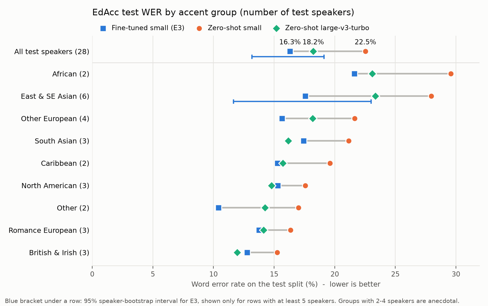

# Whisper-small fine-tuned for accented conversational English

I fine-tuned OpenAI's Whisper-small (244M parameters) on real video-call conversations between speakers of many
English accents ([EdAcc](https://huggingface.co/datasets/edinburghcstr/edacc)), measured it on speakers it never
heard, and shipped it as a CPU web service.

- **Demo:** [huggingface.co/spaces/mddalwai/whisper-small-edacc-demo](https://huggingface.co/spaces/mddalwai/whisper-small-edacc-demo)
  (record or upload up to 30 s)
- **Model:** [mddalwai/whisper-small-edacc](https://huggingface.co/mddalwai/whisper-small-edacc), and the int8 CPU
  version [mddalwai/whisper-small-edacc-ct2](https://huggingface.co/mddalwai/whisper-small-edacc-ct2)
- **Every decision, rule and result, in order:** [docs/decisions.md](docs/decisions.md). Rules were written down
  before the numbers they apply to.

## Results

EdAcc test split: 28 speakers in 14 conversations that are not in training or validation (3,341 scored clips,
4.7 h). Word error rate (WER, lower is better), greedy decoding for every model, same text normalizer for all.

| Model | Params | Test WER | Substitutions | Deletions | Insertions | LibriSpeech clean / other |
|---|---|---|---|---|---|---|
| Whisper-small, zero-shot | 244M | 22.5% | 7.8% | 11.1% | 3.6% | 3.33% / 7.45% |
| Whisper-medium, zero-shot | 769M | 19.8% | 6.5% | 11.2% | 2.1% | |
| Whisper-large-v3-turbo, zero-shot | 809M | 18.2% | 6.2% | 9.9% | 2.1% | |
| Fine-tuned (E1) | 244M | 17.2% | 9.4% | 4.2% | 3.7% | 4.70% / 10.22% |
| **Fine-tuned + LibriSpeech replay (E3, shipped)** | 244M | **16.3%** | 9.0% | 4.3% | 2.9% | 3.85% / 8.62% |



How to read this:

- **The gain over the base model is large and solid.** E3 vs zero-shot small: -6.2 points, 95% interval
  [-8.7, -4.2] (paired bootstrap over speakers, 2,000 resamples). All 3 training seeds land at 16.3%, 16.8% and
  17.1% (mean 16.75%, std 0.41).
- **Against large-v3-turbo, a model 3.3 times larger, call it on par.** E3 is 1.9 points better on test
  ([-3.2, -0.7]) but tied on validation (23.9% vs 23.8%), so the edge depends on which speakers are tested.
- **Most of the gain is transcription style, not better hearing.** Deletions fall from 11.1% to 4.3%, while
  substitutions rise from 7.8% to 9.0%. Word by word against zero-shot small: +5.7 points from words the base
  model skipped (short common words like "i", "like", "yeah"; 22% are repeats), +2.4 from words it got wrong,
  -2.6 from words it used to get right. Turbo still mishears fewer words (6.2% substitutions vs 9.0%); E3 wins
  by writing down everything EdAcc's word-for-word transcripts contain.
- **Some of the gain is the base model looping.** Zero-shot small looped on 6 short test clips ("no no no ..."
  until the output limit). Without the 14 clips where any model looped: small 20.7%, turbo 17.9%, E3 16.2%
  (a check done after seeing the results, shown next to the official numbers, not instead of them).
- **Fine-tuning hurts read speech; replay limits the damage.** E1 was 41% / 37% worse (relative) than the base on
  LibriSpeech. Mixing 15% LibriSpeech clips into training (E3) cut that to about 16% on both sets. E3 was chosen
  for this, by a rule fixed before training; its 0.9-point test edge over E1 is within seed noise.
- **First language (the comparison fixed in advance):** speakers with English as a first language (11) vs the
  rest (17): zero-shot small 23.4% vs 21.5%, turbo 18.4% vs 18.0%, E3 17.9% vs 14.5%. With this few speakers
  per side, treat it as a direction, not a finding. Per-accent groups have 2 to 6 test speakers each, so the
  chart above shows interval bars only where there are at least 5.

## What I did

1. **Data and splits.** EdAcc has 61 conversations, 122 speakers and 32.7 h of 32 kHz audio. Rules for what to
   drop (untranscribed segments, foreign-language segments, segments over 30 s, tag-only segments) were fixed
   before computing any WER. The split is by conversation, so no speaker appears in two splits: train 15.9 h
   (78 speakers), validation 2.4 h (16), test 4.7 h (28). A test fails if any utterance, speaker or
   conversation leaks across splits. A first split was thrown out before any WER, because its accent coverage
   check was too weak.
2. **Metric.** Pooled WER after Whisper's English normalizer plus a few extra rules for fillers and spellings
   (normalizer v2, unit-tested). Outputs that hit the length cap are flagged as loops and reported.
3. **Baselines.** Zero-shot Whisper-small, medium and large-v3-turbo on the same splits and settings.
4. **Training.** Full fine-tune of Whisper-small: learning rate 1e-5, effective batch 32, 2,000 steps, bf16, best
   checkpoint by validation WER. About 40 minutes per run on one A100. E3 adds 2,077 LibriSpeech
   train-clean-100 clips (7.4 h, 15% of clips) as replay. Three seeds of E3.
5. **Evaluation.** The test split was used once, for all systems in one session. Paired speaker bootstrap,
   seed spread, the forgetting check on LibriSpeech, a loop check, and a word-by-word comparison of what changed.
6. **Error analysis.** I labelled the 50 worst test clips by hand (they hold 9.6% of all errors): everyday
   words misheard in fast or accented speech 59.5% of their errors, names and rare words 20.7%, bleeped words
   6.9%, looping text 4.6%, reference errors 3.1%. Short clips are the hardest: under 1 s, WER is 80.1% (small),
   59.2% (turbo) and 50.6% (E3); on 10-30 s clips it is 14.5%, 13.1% and 11.0%.
7. **Serving.** Converted to CTranslate2 int8, checked against the original, wrapped in a FastAPI service,
   packaged with Docker and deployed as a Hugging Face Space (below).

## Serving

**Conversion check.** On 500 random validation clips, the int8 CPU model scored 22.47% WER against 22.42% for
the original model on a GPU (+0.06 points, 375 of 500 transcripts identical). A float32 conversion scored 22.33%
with 491 of 500 identical, so the serving code reproduces the original model and the rest is int8 rounding.

**The bug this check caught.** The first checks were 0.7 to 0.9 points worse, in int8 and in float32 alike. The cause:
faster-whisper pads short clips to 30 s by filling the *features* with zeros, while the model was trained on
features of *audio* padded with silence. Every clip under 30 s got input the model had never seen. The fix is
one line (pad the audio first), and a unit test now locks the serving features to the training features.
Identical transcripts went from 314 to 491 of 500.

**Service.** `POST /transcribe` takes the audio file as the request body (any common format, up to 10 MB and
30 s) and returns the text with timings. The upload limit is enforced while the body streams in, audio is
decoded in memory with the same resampling as evaluation, and nothing is stored or logged. One transcription
runs at a time; a request waits at most 30 s for its turn (503) and gets an answer within 60 s (504).
`GET /health` reports the model version, threads and start-up times.

**Image.** `python:3.12-slim`, locked package versions, the model baked in and pinned to the Hub commit that
passed the check, runs as a non-root user. 1.15 GB on disk, 373 MB compressed (built on an ARM Mac).

**Speed on the Space** (Hugging Face cpu-basic, 2 vCPUs; synthetic speech of ordinary sentences; each clip 5
times after a warm-up; round trip measured from a home connection in the US):

| Clip length | Words | Server time (median) | Round trip (median) |
|---|---|---|---|
| 2.4 s | 9 | 2.06 s | 2.56 s |
| 6.8 s | 24 | 2.31 s | 2.80 s |
| 11.9 s | 37 | 2.40 s | 2.99 s |
| 13.7 s | 51 | 2.59 s | 3.25 s |
| 19.3 s | 64 | 2.82 s | 3.43 s |

About 2 s is a fixed cost, because every clip runs through Whisper's full 30 s window; each output word adds
roughly 0.01-0.02 s. A restart takes 13-15 s until the new container answers (model load about 0.5 s, warm-up
about 2.4 s, the rest is Hugging Face starting the container). Waking the Space after it has slept was not
measured. Raw results: [results/serving](results/serving).

## Limitations

- Output is lowercase with no punctuation, and fillers and repeats are written out ("uh", "i i"), because the
  training transcripts are written that way.
- Clips of up to 30 s only. Long recordings were never evaluated.
- About 16% worse (relative) than the base model on read speech (LibriSpeech).
- Few speakers per accent group (2 to 6 in test), so per-accent results are rough.
- Trained and tested on casual video calls; other domains and noise conditions were not tested.
- Repetition can trip it: a synthetic clip that repeats one sentence 3 or 5 times came back as a single
  sentence, and 7 or 9 times came back with extra repeats. Looping also happened on 1 of 3,351 test clips.
- Not comparable with WERs in the EdAcc paper: segments over 30 s were dropped and normalization differs.
- Not for medical, legal or other high-stakes use, or as unreviewed captions.

## Reproduce

Training and evaluation ran on Google Colab (L4 for evaluation, A100 for training); serving runs anywhere with
Docker. The split files are committed and must not be regenerated.

```bash
pip install -r requirements-train.txt
pytest -q tests/

# baselines and official numbers (GPU)
python scripts/evaluate.py --model openai/whisper-small --split val --run E0_small_val
python scripts/train.py --config configs/E3.yaml --run E3
python scripts/evaluate.py --model <user>/speech-ft-E3 --split test --run E3_test
python scripts/bootstrap.py --base E0_small_test --new E3_test

# serving
python scripts/export_ct2.py --model <user>/speech-ft-E3 --out ct2/E3
python scripts/ct2_check.py --ct2 ct2/E3-int8 --compute-type int8
docker build -t speech-ft . && docker run --rm -p 7860:7860 speech-ft   # http://localhost:7860
```

## Repository

| Path | What it holds |
|---|---|
| `src/` | data loading, text normalizer, metrics, training data, serving (`asr.py`, `serve/`) |
| `scripts/` | one script per step: splits, evaluation, training, bootstrap, error analysis, export, release, Space |
| `configs/` | decoding settings used for every number, training configs, accent groups |
| `splits/` | the frozen train / validation / test lists |
| `results/` | every run: summaries and per-utterance outputs, figures, error analysis, Space timings |
| `docs/` | the decision log and the model card templates |
| `tests/` | leakage, normalizer, metrics, training labels, serving and release checks |

## License

Code: MIT ([LICENSE](LICENSE)). Text derived from EdAcc in `results/` and `splits/`: CC BY-SA 4.0. The models are
CC BY-SA 4.0 because EdAcc is. Details and citations: [NOTICE.md](NOTICE.md). No audio is stored in this repository.
